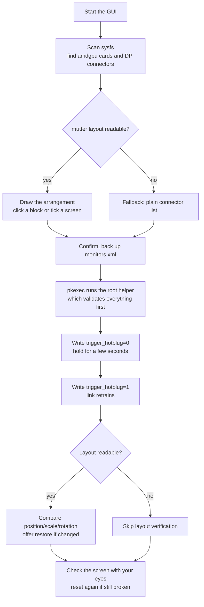
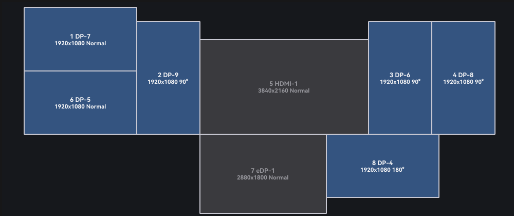

# dp-reset-gui — one-click fix for scrambled displays on eGPU docks

[中文文档](README.md) · MIT License · Go + Fyne · Author: dwSun

`dp-reset-gui` is a small Linux tool for one very specific failure of **DisplayPort monitors attached
to an AMD GPU (amdgpu) dock**:

- the whole screen is pixel-shifted — the image looks displaced by a chunk horizontally or vertically;
- a visible seam runs down (or across) the middle of the picture;
- the mouse cursor is misplaced in the same way;
- other displays usually look fine; power-cycling the monitor or replugging the cable sometimes helps,
  but that is tedious.

The tool does exactly one thing: it performs a **software unplug/replug** of the affected DP link, so the
link retrains and the sink re-locks.

> ⚠️ **This is a probabilistic mitigation, not a cure.** One click may fix it; it may also take several
> attempts. And **only your eyes can tell whether it worked**: while the image is scrambled, the software
> state still reads `status=connected`, `enabled`, `dpms=On`, exactly like a healthy link. There is no
> programmatic pass/fail signal.

## How it works (read this first)

A DisplayPort link goes through **link training** when it comes up: both sides negotiate the rate, the lane
count, and the symbol boundaries. If training ends up with a bad lock on the symbol/lane boundary, the sink
can lock onto the wrong alignment — the whole picture shifts and a seam appears, while the kernel and the
desktop still consider the link healthy.

The fix is the same thing a physical replug does: generate a hot-plug (HPD) event so the link retrains and
the sink re-locks. The software entry point is an amdgpu debugfs file (kernel side:
`amdgpu_dm_debugfs.c`):

```text
/sys/kernel/debug/dri/<PCI BDF>/<DP-N>/trigger_hotplug
```

Write `0` (simulate disconnect) → wait a moment → write `1` (simulate connect), and the link retrains once.
This tool wraps that in a GUI: it finds the resettable connectors, lets you pick screens, resets several
links with a single authorization, and snapshots the desktop layout before and after the operation.

**Out of scope:** PSR (Panel Self Refresh) flicker, driver crashes, broken hardware or cables, and
non-DP outputs.

## Workflow



## Features

| Feature | Description |
|---|---|
| Automatic detection | Scans `/sys/class/drm` to find amdgpu cards and resettable DP connectors. **No PCI address or connector whitelist is hard-coded** |
| Arrangement view | Draws the screens to scale from mutter's logical coordinates; click a block to select it, or tick it in the list below |
| One prompt, many screens | Selected connectors are passed to the root helper in one call, so you authorize once; the helper resets them one by one |
| Layout protection | Backs up `monitors.xml` before resetting, re-reads the layout afterwards, and offers the backup if position/scale/rotation changed |
| Fallback mode | On desktops without GNOME/mutter the arrangement view is replaced by a plain list; resetting still works |
| Read-only self-checks | `-selftest` / `-dump` / `-render` need no root and never touch the display; they work headless |
| Bilingual UI | Picks the language from the system locale (Chinese for `zh_CN`, English otherwise) |
| Single binary | The Python helper and the root helper are embedded at build time and released at runtime; no separate script install |

## Requirements

| Item | Required | Notes |
|---|---|---|
| Linux + amdgpu | ✅ | Only amdgpu outputs work (`trigger_hotplug` is an amdgpu debugfs interface) |
| Writable debugfs | ✅ | Normally mounted at `/sys/kernel/debug`; a read-only mount or kernel lockdown makes writes fail |
| `pkexec` (polkit) or passwordless `sudo` | ✅ | `pkexec` by default; `-use-sudo` switches to `sudo -n` |
| Graphical session + OpenGL | ✅ | Fyne needs GL; Wayland and X11 both work |
| GNOME (mutter) | Optional | The only source of desktop layout; without it the tool falls back to list mode |
| `python3` + `python3-gi` | Optional | Only used to read the mutter layout (`org.gnome.Mutter.DisplayConfig`) |
| A CJK font (ttf/otf) | Optional | Fyne's built-in font has no Chinese glyphs; needed for the Chinese UI. The tool searches via fontconfig and warns if it finds nothing |

The `python3-gi` package name varies: `python-gobject` on Arch, `python3-gi` on Debian/Ubuntu,
`python3-gobject` on Fedora.

## Installing build dependencies

Building needs **Go ≥ 1.22 with cgo**, `gcc`, `pkg-config`, and the GL / X11 / xkbcommon / wayland
development libraries. Pick your distribution:

```bash
# Arch Linux
sudo pacman -S --needed go gcc pkgconf libglvnd libx11 libxcursor libxrandr libxinerama libxi libxkbcommon wayland python-gobject

# Debian / Ubuntu
sudo apt install golang-go gcc pkg-config libgl1-mesa-dev libx11-dev libxcursor-dev libxrandr-dev libxinerama-dev libxi-dev libxkbcommon-dev libwayland-dev python3-gi

# Fedora
sudo dnf install golang gcc pkgconf mesa-libGL-devel libX11-devel libXcursor-devel libXrandr-devel libXinerama-devel libXi-devel libxkbcommon-devel wayland-devel python3-gobject
```

> The `python-gobject` / `python3-gi` / `python3-gobject` packages are runtime dependencies (for reading
> the layout), not build dependencies. At runtime the tool installs nothing and changes no system
> configuration; debugfs writes are transient kernel state and disappear on reboot.

## Building

From the repository root (the directory containing this README):

```bash
git clone https://github.com/dwSun/dp-reset-gui
cd dp-reset-gui
make build
```

The binary is written to `dist/dp-reset-gui`. Internally the Makefile runs:

```bash
CGO_ENABLED=1 go build -trimpath -ldflags "-s -w -X main.version=<version> -X main.commit=<commit>" -o dist/dp-reset-gui .
```

- `-trimpath` keeps build-machine absolute paths out of the binary; `make leaks` verifies this.
- The version defaults to `git describe --tags --always --dirty` and the commit to
  `git rev-parse --short HEAD`, falling back to `dev` / `none`. Override them with
  `make build VERSION=v1.0.0 COMMIT=abc1234`.
- The Go build cache defaults to `.gocache/` inside the repository (handy when `$HOME/.cache` is
  read-only); override with `GOCACHE=...`.
- If the modules are already cached, `GOPROXY=off make build` gives a fully offline build.

Other useful targets:

| Command | Purpose |
|---|---|
| `make test` | Run the unit tests (detection, arrangement geometry, root helper, ...) |
| `make vet` | `go vet ./...` |
| `make fmt-check` | Check gofmt without rewriting files (use this before committing) |
| `make fmt` | Rewrite source files with gofmt (local cleanup) |
| `make selftest` | Build, then run `-selftest` |
| `make render` | Build, then render the arrangement to `dist/render-check.png` with the software renderer |
| `make leaks` | Check the binary for leftover `/home/` absolute paths |
| `make release` | Build + `dist/SHA256SUMS` + leak check |
| `make run ARGS="-selftest"` | Build, then run with the given arguments |
| `make clean` | Remove `dist/` |

## Usage

### Starting the GUI

```bash
./dist/dp-reset-gui
```

Typical flow:

1. Check the GPU line and the status line at the top of the window — you should see an amdgpu card and
   something like "3 screen(s), 2 resettable".
2. Click the block of the broken screen in the arrangement (it turns orange), or tick it in the
   "Resettable screens" list below.
3. Press **"Reset selected links"**, confirm, and enter your admin password (`pkexec`).
4. The target screen blanks briefly and comes back — that is expected. Other screens are unaffected.
5. **Look at the screen.** If the picture is back to normal, you are done; if it is still broken, press
   reset again — link retraining is probabilistic.
6. The log pane shows the root helper output, whether the layout changed, and where `monitors.xml`
   was backed up.

Arrangement colours: blue = resettable, orange = selected, grey = not resettable (not DP, not connected,
or not on an amdgpu card).

### Screenshot



The image above is a rendering of the arrangement widget, produced by the `-render` software renderer.
The number, connector name, resolution, and rotation on each block let you match blocks to physical
screens — a desktop environment cannot place a window on a specific monitor, so position + rotation +
resolution is how you identify them. *Connector names and model strings in the image are illustrative.*

### Command-line flags

```text
$ ./dist/dp-reset-gui -h
Usage of ./dist/dp-reset-gui:
  -dry-run
        validate and print the plan without writing to debugfs
  -dump string
        read-only: print arrangement rectangles for a canvas size (e.g. 900x300)
  -font string
        UI font file (default: auto-detect a CJK font)
  -keep-off int
        seconds to keep the link down before retraining (default 2)
  -render string
        read-only: render the arrangement to a PNG (software renderer)
  -render-size string
        canvas size for -render (default "900x300")
  -selftest
        read-only: print detected layout/connectors and exit
  -use-sudo
        use 'sudo -n' instead of pkexec
  -version
        print version and exit
```

| Flag | Description |
|---|---|
| `-selftest` | Read-only: print GPUs, resettable connectors, and the layout table, then exit. No root, no display changes; still prints the detection results when no layout backend is available |
| `-dump 900x300` | Read-only: print the drawing rectangle (x/y/w/h/centre) of every screen for the given canvas size — useful to verify scaling, centring, and hit-testing |
| `-render out.png -render-size 1000x420` | Read-only: render the arrangement to a PNG with Fyne's software renderer; no display needed. Useful to verify glyphs and layout |
| `-version` | Print version, commit, and Go version, then exit |
| `-dry-run` | Validate and print the plan without writing debugfs. **Still requires privileges**, because the root helper must check that the debugfs file exists and is writable. `monitors.xml` is not backed up in this mode |
| `-use-sudo` | Use `sudo -n` (passwordless sudo) instead of `pkexec`; fails immediately if sudo would need a password |
| `-font /path/to/font.ttf` | Use a specific UI font (Fyne accepts ttf/otf, not ttc). Without it the tool auto-detects a CJK font via fontconfig |
| `-keep-off 5` | How many seconds to keep the link down before retraining (default 2). Increase it for stubborn cases; the GUI passes it to the root helper as `--keep-off=N` |
| `-h` | Print help |

### Read-only self-checks

These are the first things to run when something looks wrong. None of them needs root, and none of them
blanks a screen:

```bash
./dist/dp-reset-gui -selftest                            # detection results + layout table
./dist/dp-reset-gui -dump 900x300                        # arrangement geometry
./dist/dp-reset-gui -render arr.png -render-size 1000x420 # render a PNG to check glyphs
```

`-selftest` still prints the detected GPUs/connectors when no layout backend is available; `-dump` and
`-render` need a readable layout (i.e. `python3-gi`), otherwise they exit with "failed to read layout".

Sample `-selftest` output (fictional values):

```text
GPU card0  0000:03:00.0  amdgpu · hot-pluggable dock GPU
GPU card1  0000:00:02.0  i915 · built-in
resettable connectors: card0-DP-4 card0-DP-5
mutter serial=7  screens=3
  #  CONNECTOR CARD    PRODUCT    MODE       ROT   POS          LOGICAL     SCALE  STATUS     FLAGS
  1  DP-4      card0   Example    2560x1440  0°    (0,0)        2560x1440   1      connected  resettable
  2  DP-5      card0   Example    1920x1080  90°   (2560,0)     1080x1920   1      connected  resettable
  3  eDP-1     card1   Laptop     2880x1800  0°    (2560,1080)  2160x1350   1.33   connected  [primary]
```

Sample `-dump` output:

```text
canvas 900x300 (logical layout scaled and centered)
 1  DP-4      rect x= 100.0 y=  20.0 w= 300.0 h= 150.0  center=( 250.0,  95.0)  resettable
 2  DP-5      rect x= 420.0 y=  20.0 w= 150.0 h= 300.0  center=( 495.0, 170.0)  resettable
```

### UI language (i18n)

UI strings are managed with Fyne's `fyne.io/fyne/v2/lang` (go-i18n format) and live in `translations/`:

- `translations/en.json` — English (also the fallback when a key is missing);
- `translations/zh_CN.json` — Simplified Chinese.

The language is chosen from the system locale: `zh_CN` gets Chinese, everything else falls back to
English (`en.json`). The root helper picks Chinese or English output depending on whether the locale
starts with `zh`. Translation files are flat `key → text` maps with `{{.Name}}` placeholders.

Adding a language requires no code changes: copy `translations/en.json` to `<locale>.json` and translate
it. **The file name must be the full locale** — `zh_CN.json` works, while `zh.json` will not match
`zh_CN`. The root helper's output language is passed by the GUI as `--lang=zh_CN` or `--lang=en`
(`pkexec` scrubs the environment, so an environment variable would not survive).

## How detection works

### Which connectors can be reset

The tool scans `/sys/class/drm` read-only (no root needed). Every rule is derived from live data — nothing
is hard-coded:

| Decision | Source |
|---|---|
| Card | `/sys/class/drm/cardN/device/driver` must resolve to `amdgpu` |
| PCI address | The PCI BDF that `/sys/class/drm/cardN/device` resolves to |
| Connector name | Must be `DP-N` (e.g. `DP-4`); `eDP-*`, `HDMI-*`, and MST child connectors (`DP-1-1` and friends) are excluded |
| Connection state | `/sys/class/drm/cardN-DP-N/status` must be `connected` |
| Hot-pluggable | `/sys/bus/pci/devices/<BDF>/removable` is `removable` (common for Thunderbolt/USB4 docks) |
| Built-in card | The card exposes `eDP-` / `LVDS-` / `DSI-` connectors |

Only connectors that are **amdgpu + `DP-N` + `connected`** appear in the resettable list. Other screens
are still drawn in the arrangement, but greyed out and not selectable.

The root helper does not trust what the GUI sends: it re-derives the BDF, driver name, and `status`
from sysfs and validates every argument. If a single argument is invalid, it rejects the whole batch
and executes nothing.

### Layout backend and fallback

Desktop layout (position, scale, rotation, primary flag of each screen) is only available from
GNOME/mutter, via `org.gnome.Mutter.DisplayConfig.GetCurrentState` on the session bus (no root needed).
An embedded Python helper reads it and returns JSON to the Go side.

- mutter does not report logical width/height directly; the tool computes them as
  "current mode pixel size ÷ scale", swapping width and height for 90°/270° rotation.
- Whether a screen is resettable is decided by the Go side from sysfs, not by the Python helper, so the
  two cannot disagree about a whitelist.
- When the layout is unavailable (not GNOME, no `python3-gi`, no session bus, ...) the UI falls back:
  no arrangement drawing, only the resettable connector list. Resetting still works, but the
  before/after layout comparison is skipped.

### Timeline of one reset

For each connector the root helper runs:

```text
write trigger_hotplug=0 → sleep 1 → hold off for N seconds (default 2, adjustable with -keep-off) → write trigger_hotplug=1 → sleep 2 → read status
```

The hold-off time defaults to 2 seconds and can be changed with the GUI's `-keep-off N` flag, which is
passed to the root helper as `--keep-off=N`. When running the helper directly as root you can also use the
`DP_RESET_KEEP_OFF` environment variable — note that `pkexec` scrubs the environment, so the GUI always
uses the argument form.

`DP_RESET_DEBUGFS_ROOT` and `DP_RESET_SYSFS_ROOT` exist for testing against fake trees and should not be
set in normal use. The GUI's timeout for the helper call is
`30 + (15 + hold-off seconds) × number of connectors`; an unanswered authorization prompt ends in a
timeout error.

Root helper exit codes:

| Code | Meaning |
|---|---|
| `0` | Success (or a successful `--dry-run` validation) |
| `2` | Bad argument or precondition (invalid/missing connector, not amdgpu, not connected, non-numeric `--keep-off` / `DP_RESET_KEEP_OFF`, ...) |
| `3` | Not root (not invoked through pkexec/sudo) |
| `4` | debugfs unavailable (file missing, not writable, or — in an extreme case — `sleep` not in `PATH`) |
| `5` | Failed to write `trigger_hotplug` |

## Security model

```text
GUI (normal user)
  └─ pkexec  $XDG_DATA_HOME/dp-reset-gui/dp-reset-root --lang=en card0-DP-4 [card0-DP-5 ...]
                └─ validates everything first: cardN-DP-N shape, connector exists, driver=amdgpu,
                   status=connected, debugfs writable
                └─ writes only trigger_hotplug (0 → wait → 1); touches no other connector and no config file
```

- The GUI runs as a normal user. The root helper and the Python layout helper are embedded with
  `//go:embed` and released to `$XDG_DATA_HOME/dp-reset-gui/` (default `~/.local/share/dp-reset-gui/`)
  the first time a reset (including `-dry-run`) runs. They are refreshed whenever the binary's contents
  change and can be inspected directly.
- Before resetting, a timestamped copy of `monitors.xml` is made (respecting `XDG_CONFIG_HOME`), e.g.
  `~/.config/monitors.xml.bak-YYYYMMDD-HHMMSS`. The tool itself never modifies `monitors.xml`.
- Read-only self-checks (`-selftest` / `-dump` / `-render`) release no scripts and need no root.

**Known boundary, stated honestly:** the root helper lives in a user-writable directory, and `pkexec`
only checks that you are an administrator — it does not verify the script contents. A user who can modify
that directory can therefore obtain root. This is the trade-off for a single-binary, install-free tool.
The stricter deployment is to install the helper under `/usr/libexec/` with a polkit policy that allows
only that exact path to run as root; **this version does not implement that**.

## Known limitations

1. **Resetting is probabilistic.** It may work on the first try, or take many attempts; each attempt is
   an independent roll of the dice.
2. **Software cannot judge the picture.** While scrambled, `status=connected`, `enabled`, and `dpms=On`
   are all true, so only your eyes can confirm success.
3. **DP outputs only.** eDP (internal panel), HDMI, and MST child connectors are not selectable — they
   either lack this debugfs entry or are not a whole link.
4. **The arrangement view needs GNOME/mutter.** Other desktops get list mode only, with no position or
   rotation information.
5. **A read-only or restricted debugfs blocks resets.** Some kernel configurations (e.g. lockdown) refuse
   debugfs writes.
6. **Docks with several identical EDIDs may have their layout recomputed by mutter** after a hot-plug.
   That is why `monitors.xml` is backed up automatically and the layout is compared afterwards; if it
   changed, the tool tells you how to restore the backup.
7. **It is not a substitute for hardware troubleshooting.** Bad cable contact, dock power/firmware issues,
   and GPU hardware faults can produce similar symptoms; a reset only helps with a badly trained link.
8. **No PSR flicker, driver crash, or hardware-damage handling.**

## Troubleshooting

Start with `./dist/dp-reset-gui -selftest`; it answers most questions.

| Symptom | Diagnose | Fix |
|---|---|---|
| `no resettable connector found` / empty list | `ls /sys/class/drm/`; `cat /sys/class/drm/card0-DP-4/status`; `readlink -f /sys/class/drm/card0/device/driver` | Make sure the driver is amdgpu, the connector is `DP-N` (not eDP/HDMI/MST), and `status` is `connected`; the dock's DP port must actually be connected and recognised |
| `-selftest` lists connectors, but the GUI shows none or greys them out | Compare the `CONNECTOR` column of `-selftest` with `ls /sys/class/drm/`; check "Layout source" in the log | The layout's connector name may differ from the sysfs name (e.g. MST child connectors), or the screen is not part of the mutter layout; such connectors cannot be reset by design |
| `pkexec` does nothing or reports denial (exit 126) | Make sure a polkit authentication agent is running; `pkexec --version` | Retry from a session that can show the prompt, or use `-use-sudo` (requires passwordless sudo) |
| `pkexec` cannot start the helper (exit 127) | `which pkexec`; read the root helper output in the log | Install polkit, or use `-use-sudo` |
| debugfs unavailable / cannot write | `mount \| grep debug`; `ls /sys/kernel/debug/dri/` | If debugfs is mounted read-only: `sudo mount -o remount,rw /sys/kernel/debug`. Kernel lockdown cannot be worked around this way |
| Chinese text shows as boxes | `fc-list :lang=zh \| head`; check "UI font" in the log | Install a CJK font (e.g. Noto Sans CJK) or pass `-font /path/to/font.ttf` |
| Log says the layout could not be read; no arrangement view | `python3 -c 'import gi; print("gi ok")'` | Install `python3-gi` (package names above); make sure you are in a GNOME session. Resetting still works without a layout; only the comparison is skipped |
| The screen blanks briefly after a reset | — | Expected: the link goes down and retrains. Give it a few seconds |
| The layout changed after a reset (position/scale/rotation) | The log shows the backup path | Restore it: `cp ~/.config/monitors.xml.bak-YYYYMMDD-HHMMSS ~/.config/monitors.xml`, then log out and back in |
| Reset times out | The timeout is `30 + 15 × connectors` seconds | Usually an unanswered authorization prompt; confirm and retry |
| The root helper failed | Read its output and exit code in the log | Map the exit code with the table above (argument/permission/debugfs/write failure) |
| Want to see the plan without touching anything | `./dist/dp-reset-gui -dry-run` | Validates and prints the plan, writes nothing (still needs authorization) |

## FAQ

**Why not just turn the output off/on with `xrandr` or DPMS?**
That only toggles the output or performs another modeset; it does not retrain the DP link. The corruption
happens at the link-training level (wrong symbol boundary), which needs a hot-plug event to retrain.
`trigger_hotplug` simulates exactly that event.

**Then why not just unplug the cable?**
Physically replugging works on the same principle and often does help. But a dock usually drives several
monitors, so it is easy to unplug the wrong one and disturb the others, and you have to get up each time.
This tool triggers a hot-plug only for the connectors you select. If replugging does not help either, the
problem is probably elsewhere (cable, dock, EDID); a reset is not magic.

**Will it affect other screens?**
It does not retrain other links. However, a hot-plug event can make mutter recompute the layout
(especially with several identical EDIDs), which is why the tool backs up `monitors.xml` first, compares
the layout afterwards, and offers the backup if something changed.

**Does it modify my configuration?**
The tool writes no configuration files itself. The only disk writes are releasing the embedded helpers
to `$XDG_DATA_HOME/dp-reset-gui/` and backing up `monitors.xml`. The desktop environment may rewrite
`monitors.xml` on its own after a hot-plug — that is mutter's behaviour, and the backup/comparison exists
because of it.

**Does it need root?**
The GUI runs as a normal user; performing a reset needs root (via `pkexec` or `sudo -n`).
The read-only self-checks (`-selftest` / `-dump` / `-render`) need no root at all.

**Does it support NVIDIA or Intel GPUs?**
No. `trigger_hotplug` is an amdgpu debugfs interface. `-selftest` still lists cards from other drivers,
but their connectors are not resettable.

**Wayland or X11?**
Either. Reading the layout uses GNOME/mutter's D-Bus API and is display-protocol agnostic; non-GNOME
desktops fall back to list mode.

**How many screens can be reset at once?**
Any number. All selected connectors are passed to the root helper in one call (one authorization), and
the helper resets them sequentially. The timeout grows with the connector count
(`30 + 15 × connectors` seconds).

**Can it be scripted?**
The read-only parts can: `-selftest`, `-dump`, and `-render` produce stable text output suitable for
parsing. An actual reset needs interactive authorization; `-dry-run` lets you rehearse it first.

**The reset worked, but there is nothing in dmesg?**
Successful training usually logs nothing; failures may show amdgpu messages such as
`enabling link failed`. So "no new log" does not mean "it failed", and a failure log means that attempt
did not take. Confirm the final result with your eyes.

**Is this the same as screen flicker (PSR)?**
No. PSR is a panel self-refresh power-saving feature that causes flicker; this tool does not address it.

## Repository layout

```text
.
├── main.go                     CLI entry point, flags, font detection, -selftest/-dump/-render
├── ui.go                       UI assembly, theme font injection, log/result rendering
├── discover.go                 sysfs detection and classification (GPU / connector / resettability)
├── layout.go                   mutter layout backend, embedded asset release, State/Signature
├── reset.go                    backup → privilege escalation → validation → layout comparison
├── arrange.go                  arrangement widget (scaling, centring, hit-testing, labels)
├── i18n.go                     translation loading, tr(), locale detection
├── assets/
│   ├── sys_layout.py           Python helper reading mutter's DisplayConfig
│   └── dp-reset-root           root helper (validation + trigger_hotplug 0→1)
├── translations/
│   ├── en.json                 English strings (fallback)
│   └── zh_CN.json              Simplified Chinese strings
├── scripts/
│   ├── check-leaks.sh          check the binary for /home/ path leaks
│   └── render-check.sh         headless render self-check
├── docs/
│   ├── arrangement-example-zh.png   arrangement example (Chinese)
│   └── arrangement-example-en.png   arrangement example (English)
├── Makefile                    build / test / self-check / release targets
├── CHANGELOG.md                release history
├── LICENSE                     MIT
└── README.md / README.en.md    Chinese / English documentation
```

## License and disclaimer

Released under the [MIT License](LICENSE).

The tool writes to kernel debugfs as root and can briefly blank the target screen. Although it only
touches the selected DP links, please evaluate the risk yourself and try it in a recoverable environment
first. The software is provided "as is", without warranty of any kind; the authors are not liable for
display problems, lost configuration, or any other damage resulting from its use.
This project is not affiliated with AMD.

## Contributing

Issues and pull requests are welcome. When reporting a problem, please include as much of the following
as you can:

- the relevant amdgpu lines from `dmesg` (or `journalctl -k`), especially anything like
  `enabling link failed`;
- GPU model (and the PCI BDF if you are comfortable sharing it), kernel version, distribution, desktop
  environment (GNOME/KDE/...), and whether you are on Wayland or X11;
- the dock model and the affected monitor's model/resolution/refresh rate;
- the output of `./dist/dp-reset-gui -selftest` (redact anything sensitive — it can contain monitor
  model strings).

Before opening a PR, make sure `make fmt-check`, `make test`, and `make vet` pass; for release-related
changes, run `make leaks` as well.
