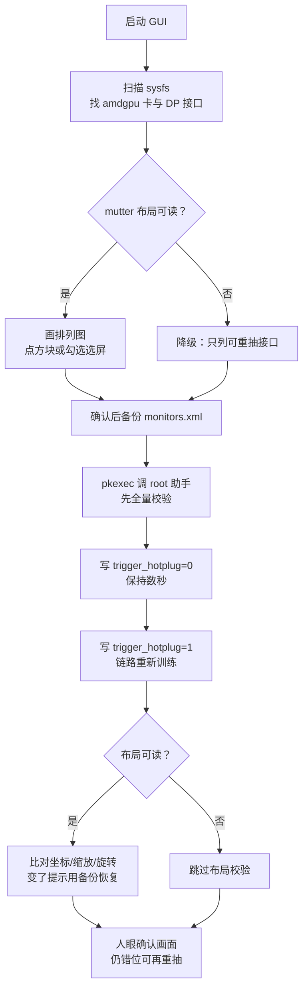
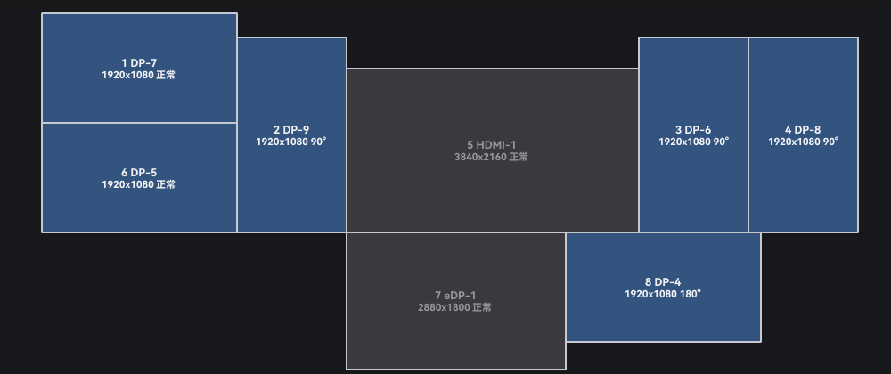

# dp-reset-gui —— 扩展坞屏幕整屏错位的一键修复

[English version](README.en.md) · MIT License · Go + Fyne · 作者：dwSun

`dp-reset-gui` 是一个 Linux 小工具，专门处理 **AMD 显卡（amdgpu）外接扩展坞上的 DP 显示器**出现的一种特定故障：

- 整块屏的像素整体错位，画面像被水平或垂直挪了一段；
- 画面中间出现一条明显的竖向（或横向）拼接线；
- 鼠标光标在同一位置也跟着错位、错行；
- 其它屏幕通常正常；重新开关显示器、重插线缆有时能恢复，但很麻烦。

工具只做一件事：对出问题的那条 DP 链路做一次**软件拔插**，让链路重新训练、接收端重新锁定。

> ⚠️ **这是概率性缓解，不是根治。** 一次可能就好，也可能要连点几次。而且**成功与否只能靠人眼看**：
> 错位发生时，软件侧读到的 `status=connected`、`enabled`、`dpms=On` 与正常时完全一样，
> 没有任何可编程的判据能告诉你"这次抽中了没有"。

## 原理（先读这段）

DisplayPort 链路在建立时会做 **link training**（链路训练）：双方协商速率、通道数，并确定符号边界。
训练结果不理想时，接收端可能锁到错误的符号/通道边界上，于是整屏像素错位、中间出现拼接线——
而内核和桌面环境都认为这条链路"正常"。

修复思路和**物理拔插**一样：制造一次热插拔（HPD）事件，让链路重新训练、接收端重新锁定。
软件上对应的入口是 amdgpu 的 debugfs 文件（内核代码在 `amdgpu_dm_debugfs.c`）：

```text
/sys/kernel/debug/dri/<PCI BDF>/<DP-N>/trigger_hotplug
```

向它写 `0`（模拟断开）→ 等待一小段时间 → 写 `1`（模拟插入），链路就会重新训练一次。
本工具把这一步包装成了 GUI：自动找出可重抽的接口、让你点选屏幕、一次授权重抽多屏，
并在操作前后各读一次桌面布局做对比。

**它不处理**：PSR（Panel Self Refresh）导致的闪烁、驱动崩溃、硬件/线缆损坏、非 DP 输出接口。

## 工作流程



## 功能

| 功能 | 说明 |
|---|---|
| 自动探测 | 扫描 `/sys/class/drm` 自动识别 amdgpu 卡与可重抽的 DP 接口，**不写死任何机器专属的 PCI 地址或接口号** |
| 排列图选择 | 按 mutter 逻辑坐标等比绘制屏幕排列，点方块即选中；也可在下方列表勾选 |
| 一次授权多屏 | 选中的多个接口一次传给 root 助手，只需输入一次密码，助手内部逐个重抽 |
| 布局保护 | 执行前备份 `monitors.xml`；执行后重读布局，坐标/缩放/旋转变了会弹窗提示如何用备份恢复 |
| 降级模式 | 非 GNOME/mutter 桌面自动降级为"只列接口"：排列图不画，重抽功能照常可用 |
| 只读自检 | `-selftest` / `-dump` / `-render` 不需要 root、不碰屏幕，可在无人看屏的环境下核对探测与渲染 |
| 中英双语 | 按系统 locale 自动切换（zh → 中文，其余 → 英文） |
| 单二进制 | Python 助手与 root 助手在编译时内嵌，运行时释放，不需要随包分发脚本 |

## 环境要求

| 项 | 必需 | 说明 |
|---|---|---|
| Linux + amdgpu | ✅ | 只支持 amdgpu 的输出（`trigger_hotplug` 是 amdgpu 的 debugfs 接口） |
| debugfs 已挂载且可写 | ✅ | 通常挂在 `/sys/kernel/debug`；只读挂载或内核 lockdown 会导致写入失败 |
| `pkexec`（polkit）或免密 `sudo` | ✅ | 默认走 `pkexec`；`-use-sudo` 改用 `sudo -n` |
| 图形会话 + OpenGL | ✅ | Fyne 需要 GL；Wayland / X11 均可 |
| GNOME（mutter） | 可选 | 只有它能提供桌面布局。没有则降级为列表模式 |
| `python3` + `python3-gi` | 可选 | 仅用于读取 mutter 布局（`org.gnome.Mutter.DisplayConfig`） |
| 含中文的 ttf/otf 字体 | 可选 | Fyne 内置字体没有中文字形；中文界面需要。程序会先用 fontconfig 找，找不到会提示 |

`python3-gi` 的包名因发行版而异：Arch 是 `python-gobject`，Debian/Ubuntu 是 `python3-gi`，Fedora 是 `python3-gobject`。

## 安装构建依赖

构建需要 **Go ≥ 1.22 + cgo**、`gcc`、`pkg-config`，以及 GL / X11 / xkbcommon / wayland 的开发库。
按发行版任选一条：

```bash
# Arch Linux
sudo pacman -S --needed go gcc pkgconf libglvnd libx11 libxcursor libxrandr libxinerama libxi libxkbcommon wayland python-gobject

# Debian / Ubuntu
sudo apt install golang-go gcc pkg-config libgl1-mesa-dev libx11-dev libxcursor-dev libxrandr-dev libxinerama-dev libxi-dev libxkbcommon-dev libwayland-dev python3-gi

# Fedora
sudo dnf install golang gcc pkgconf mesa-libGL-devel libX11-devel libXcursor-devel libXrandr-devel libXinerama-devel libXi-devel libxkbcommon-devel wayland-devel python3-gobject
```

> 上面的 `python-gobject` / `python3-gi` / `python3-gobject` 是运行时依赖（读布局用），构建本身不需要它们。
> 本工具运行时不安装任何东西、不修改系统配置；写入 debugfs 是临时的内核状态，重启即消失。

## 构建

在仓库根目录（本 README 所在目录）执行：

```bash
git clone https://github.com/dwSun/dp-reset-gui
cd dp-reset-gui
make build
```

产物是 `dist/dp-reset-gui`。Makefile 内部等价于：

```bash
CGO_ENABLED=1 go build -trimpath -ldflags "-s -w -X main.version=<版本> -X main.commit=<提交>" -o dist/dp-reset-gui .
```

- `-trimpath` 保证二进制里不残留构建机的绝对路径；`make leaks` 会检查这一点。
- 版本号默认取 `git describe --tags --always --dirty`，提交号取 `git rev-parse --short HEAD`；拿不到时回退为 `dev` / `none`。也可手动指定：
  `make build VERSION=v1.0.0 COMMIT=abc1234`。
- Go 构建缓存默认放在仓库内 `.gocache/`（便于 `$HOME/.cache` 只读的环境）；可用 `GOCACHE=...` 覆盖。
- 依赖已在模块缓存里时，可加 `GOPROXY=off` 做完全离线构建。

其它常用目标：

| 命令 | 作用 |
|---|---|
| `make test` | 跑单元测试（探测、排列图几何、root 助手等） |
| `make vet` | `go vet ./...` |
| `make fmt-check` | 只检查 gofmt，不改文件（提交前用这个） |
| `make fmt` | 直接改写源文件（本地整理代码用） |
| `make selftest` | 构建后跑 `-selftest` |
| `make render` | 构建后用软件渲染器出图到 `dist/render-check.png` |
| `make leaks` | 检查二进制里是否残留 `/home/` 绝对路径 |
| `make release` | 构建 + `dist/SHA256SUMS` + 泄漏检查 |
| `make run ARGS="-selftest"` | 构建后带参数运行 |
| `make clean` | 删除 `dist/` |

## 用法

### 启动 GUI

```bash
./dist/dp-reset-gui
```

操作顺序：

1. 看窗口顶部的 GPU 信息行与状态行，确认探测到了 amdgpu 卡和可重抽接口（例如"共 3 块屏，2 块可重抽"）。
2. 在排列图上点击出问题的屏幕方块（选中变橙色），或在下方"可重抽的屏幕"列表里勾选。
3. 点 **"重抽选中链路"**，确认对话框后输入管理员密码（`pkexec`）。
4. 目标屏会黑一下再亮起，属于正常现象；其它屏不受影响。
5. **用眼睛看**：画面恢复正常就结束了；仍然错位就再点一次——链路重训是概率事件。
6. 日志区会显示 root 助手输出、布局是否被改动、`monitors.xml` 的备份路径。

排列图配色：蓝色 = 可重抽，橙色 = 已选中，灰色 = 不可重抽（非 DP、未连接，或不在 amdgpu 卡上）。

### 界面示例



上图是排列图控件的渲染示例（由 `-render` 软件渲染器生成）。方块上的编号、接口名、分辨率、旋转角度
用于和真实屏幕一一对照——桌面环境无法指定窗口落到哪块显示器，所以靠"排列位置 + 旋转 + 分辨率"来辨认。
*图中接口名与型号仅作示意。*

### 命令行参数

```text
$ ./dist/dp-reset-gui -h
Usage of ./dist/dp-reset-gui:
  -dry-run
        只校验并打印计划，不写 debugfs
  -dump string
        只读：按画布尺寸打印排列图各屏矩形（如 900x300）
  -font string
        界面字体文件（默认自动挑选中文字体）
  -keep-off int
        断开后保持多少秒再重训（默认 2 秒）
  -render string
        只读：用软件渲染器把排列图渲染成 PNG
  -render-size string
        配合 -render 的画布尺寸 (default "900x300")
  -selftest
        只读：打印检测到的布局/接口后退出
  -use-sudo
        用 'sudo -n' 代替 pkexec
  -version
        打印版本后退出
```

| 参数 | 说明 |
|---|---|
| `-selftest` | 只读：打印 GPU、可重抽接口、布局表格后退出。不需要 root、不碰屏；没有布局后端时仍会打印探测结果 |
| `-dump 900x300` | 只读：按给定画布尺寸打印排列图里每块屏的绘制矩形（x/y/w/h/中心点），用来核对缩放、居中与命中判定 |
| `-render out.png -render-size 1000x420` | 只读：用 Fyne 软件渲染器把排列图渲染成 PNG，不需要显示器；用来核对字形和布局 |
| `-version` | 打印版本、commit、Go 版本后退出 |
| `-dry-run` | 只校验参数并打印计划，不写 debugfs。**仍需提权**，因为 root 助手要检查 debugfs 文件是否存在、是否可写；不会备份 `monitors.xml` |
| `-use-sudo` | 用 `sudo -n`（免密 sudo）代替 `pkexec`；没有免密 sudo 时会直接失败 |
| `-font /path/to/font.ttf` | 指定界面字体（Fyne 只接受 ttf/otf，不接受 ttc）。不指定时自动用 fontconfig 找中文字体 |
| `-keep-off 5` | 断开后保持多少秒再重训（默认 2）。顽固错位可以加大；GUI 会以 `--keep-off=N` 传给 root 助手 |
| `-h` | 打印帮助 |

### 只读自检

这三个命令是排查问题的第一步，都不需要 root、不会让屏幕黑屏：

```bash
./dist/dp-reset-gui -selftest                      # 探测结果 + 布局表
./dist/dp-reset-gui -dump 900x300                  # 排列图几何
./dist/dp-reset-gui -render arr.png -render-size 1000x420   # 渲染出图，核对字形
```

其中 `-selftest` 在没有布局后端时仍会打印探测到的 GPU/接口；`-dump` 和 `-render` 需要能读到布局
（即 `python3-gi` 可用），否则会以"读取布局失败"退出。

`-selftest` 输出格式示意（数值为虚构示例）：

```text
GPU card0  0000:03:00.0  amdgpu · 可热插拔（扩展坞 GPU）
GPU card1  0000:00:02.0  i915 · 内置
可重抽接口：card0-DP-4 card0-DP-5
mutter serial=7  屏数=3
  #  CONNECTOR CARD    PRODUCT    MODE       ROT   POS          LOGICAL     SCALE  STATUS     FLAGS
  1  DP-4      card0   Example    2560x1440  0°    (0,0)        2560x1440   1      connected  可重抽
  2  DP-5      card0   Example    1920x1080  90°   (2560,0)     1080x1920   1      connected  可重抽
  3  eDP-1     card1   Laptop     2880x1800  0°    (2560,1080)  2160x1350   1.33   connected  [主屏]
```

`-dump` 输出格式示意：

```text
画布 900x300（按逻辑坐标等比缩放并居中）
 1  DP-4      rect x= 100.0 y=  20.0 w= 300.0 h= 150.0  center=( 250.0,  95.0)  可重抽
 2  DP-5      rect x= 420.0 y=  20.0 w= 150.0 h= 300.0  center=( 495.0, 170.0)  可重抽
```

### 界面语言（i18n）

界面文案用 Fyne 自带的 `fyne.io/fyne/v2/lang`（go-i18n 格式）管理，翻译文件在 `translations/`：

- `translations/en.json` —— 英文（也是缺 key 时的兜底文案）；
- `translations/zh_CN.json` —— 简体中文。

语言按系统 locale 自动选择：`zh_CN` 使用中文文案，其余语言回退到英文（`en.json`）。
root 助手的输出语言按 locale 是否以 `zh` 开头选择中文或英文。文件是扁平的 `key → 文案` 映射，
模板占位符形如 `{{.Name}}`。

新增语言不需要改代码：复制 `translations/en.json` 为 `<locale>.json` 并翻译即可。
**文件名必须是完整 locale**——`zh_CN.json` 会生效，而 `zh.json` 不会被 `zh_CN` 匹配到。
root 助手的输出语言由 GUI 通过 `--lang=zh_CN` 或 `--lang=en` 传入（`pkexec` 会清理环境变量，所以不能用环境变量传）。

## 探测与工作原理

### 哪些接口可重抽

工具只读扫描 `/sys/class/drm`（普通用户即可），规则全部来自现场数据，没有任何硬编码：

| 判定 | 依据 |
|---|---|
| 显卡 | `/sys/class/drm/cardN/device/driver` 解析出的驱动名必须是 `amdgpu` |
| PCI 地址 | `/sys/class/drm/cardN/device` 这个符号链接解析出的 PCI BDF |
| 接口名 | 必须是 `DP-N`（如 `DP-4`）；`eDP-*`、`HDMI-*`、MST 子接口（`DP-1-1` 这类）都不在范围内 |
| 连接状态 | `/sys/class/drm/cardN-DP-N/status` 必须是 `connected` |
| 可热插拔 | `/sys/bus/pci/devices/<BDF>/removable` 为 `removable`（Thunderbolt/USB4 扩展坞常见） |
| 内置卡 | 该卡上有 `eDP-` / `LVDS-` / `DSI-` 接口 |

只有同时满足 **amdgpu + `DP-N` + `connected`** 的接口才会出现在可重抽列表里。
其余屏幕仍会画在排列图上，但显示为灰色、不可选。

root 助手不信任 GUI 传来的结果：它会自己再从 sysfs 现场解析 BDF、驱动名、`status`，
逐条校验参数，任何一条不合法就整体拒绝、一条都不执行。

### 布局后端与降级

桌面布局（每块屏的坐标、缩放、旋转、主屏标记）只有 GNOME/mutter 能提供：
通过 `org.gnome.Mutter.DisplayConfig.GetCurrentState`（会话总线，无需 root）读取，
由一个内嵌的 Python 助手完成，结果以 JSON 返回给 Go 侧。

- mutter 的逻辑屏不直接给宽高，工具按"当前模式像素尺寸 ÷ 缩放"计算；旋转 90°/270° 时宽高互换。
- 每块屏"能否重抽"不由 Python 判断，而是由 Go 侧从 sysfs 补齐，避免两处白名单不一致。
- 读不到布局（非 GNOME、没装 `python3-gi`、会话总线不可用等）时自动降级：
  排列图不画，只列可重抽接口；重抽功能照常可用，但**跳过执行前后的布局比对**。

### 一次重抽的时间线

root 助手对每个接口依次执行：

```text
写 trigger_hotplug=0  → sleep 1 → 保持断开 N 秒（默认 2，可用 -keep-off 调整）→ 写 trigger_hotplug=1 → sleep 2 → 读 status
```

断开保持的秒数默认 2 秒，可以用 GUI 的 `-keep-off N` 调整（作为 `--keep-off=N` 参数传给 root
助手）。直接以 root 运行助手时也可以用环境变量 `DP_RESET_KEEP_OFF`；注意经 `pkexec` 调用时环境
变量会被清理，所以 GUI 一律走参数。

另外还有 `DP_RESET_DEBUGFS_ROOT` / `DP_RESET_SYSFS_ROOT` 两个变量，仅用于测试时指向假的
debugfs / sysfs 目录树，正常使用不要设置。
GUI 调用助手时的超时是 `30 + (15 + 断开保持秒数) × 接口数` 秒；如果授权对话框一直没响应，
会以超时错误结束。

root 助手的退出码：

| 退出码 | 含义 |
|---|---|
| `0` | 全部完成（或 `--dry-run` 校验通过） |
| `2` | 参数或前置条件不满足（接口名非法、不存在、非 amdgpu、未连接、`--keep-off` / `DP_RESET_KEEP_OFF` 非数字等） |
| `3` | 不是 root（没有通过 pkexec/sudo 调用） |
| `4` | debugfs 不可用（文件不存在、不可写，或极端情况下 PATH 里没有 `sleep`） |
| `5` | 写入 `trigger_hotplug` 失败 |

## 安全模型

```text
GUI（普通用户）
  └─ pkexec  $XDG_DATA_HOME/dp-reset-gui/dp-reset-root --lang=zh_CN card0-DP-4 [card0-DP-5 ...]
                └─ 先全量校验：参数形如 cardN-DP-N、接口存在、driver=amdgpu、status=connected、debugfs 可写
                └─ 只写 trigger_hotplug（0 → 等待 → 1），不碰其它 connector、不改任何配置文件
```

- GUI 以普通用户身份运行；root 助手和 Python 布局助手在编译时 `//go:embed` 进二进制，
  首次执行重抽（含 `-dry-run`）时释放到 `$XDG_DATA_HOME/dp-reset-gui/`（默认 `~/.local/share/dp-reset-gui/`），
  内容随二进制版本自动更新，可以直接打开审阅。
- 执行前会用带时间戳的副本备份 `monitors.xml`（遵循 `XDG_CONFIG_HOME`），
  路径形如 `~/.config/monitors.xml.bak-YYYYMMDD-HHMMSS`。工具自身**不修改** `monitors.xml`。
- 只读自检（`-selftest` / `-dump` / `-render`）不释放任何脚本、不需要 root。

**已知边界（老实说）**：root 助手放在用户可写目录里，而 `pkexec` 只校验"你是不是管理员"、
不校验脚本内容——所以能修改那个目录的用户，等于能拿到 root。这是为了"单个二进制、免安装即可运行"
做的取舍。更严格的部署方式是把它装到 `/usr/libexec/` 并配一份 polkit 策略，只允许固定路径的助手
以 root 执行；这一版**没有实现**。

## 已知限制

1. **重抽是概率性的**：可能一次成功，也可能要试很多次；每次都是独立的一次"抽奖"。
2. **画面好坏软件无法判定**：错位时 `status=connected`、`enabled`、`dpms=On` 同样成立，只能人眼确认。
3. **只支持 DP 输出**：eDP（内屏）、HDMI、MST 子接口都不可选——它们没有这条 debugfs 入口，
   或者不属于"整条链路"这一层。
4. **排列图依赖 GNOME/mutter**：其它桌面只有列表模式；坐标/旋转信息也读不到。
5. **debugfs 只读或受限时无法重抽**：部分内核配置（如 lockdown）会拒绝写 debugfs。
6. **多屏同 EDID 的扩展坞在热插拔后，mutter 可能重算布局**：所以工具在重抽前一律自动备份
   `monitors.xml`，重抽后再比对一次布局；变了会提示用备份恢复。
7. **不能替代硬件排查**：线缆接触不良、扩展坞供电/固件问题、显卡硬件故障都可能表现成类似症状，
   重抽只能解决"链路训练没抽好"这一类。
8. **不处理 PSR 闪烁、驱动崩溃、硬件损坏**。

## 故障排查

先跑 `./dist/dp-reset-gui -selftest`，大多数问题能从这里看出来。

| 现象 | 诊断 | 处理 |
|---|---|---|
| 提示 `no resettable connector found` / 列表为空 | `ls /sys/class/drm/`；`cat /sys/class/drm/card0-DP-4/status`；`readlink -f /sys/class/drm/card0/device/driver` | 确认驱动是 amdgpu、接口名是 `DP-N`（不是 eDP/HDMI/MST）、`status` 是 `connected`；扩展坞的 DP 口要真的接上并已识别 |
| `-selftest` 能看到接口，但 GUI 列表里没有或显示灰色 | 对比 `-selftest` 的 `CONNECTOR` 列与 `ls /sys/class/drm/`；看日志里的"布局来源" | 可能是布局里的 connector 名与 sysfs 命名不一致（如 MST 子接口），或该屏不在 mutter 布局中；此类接口本来就不支持重抽 |
| `pkexec` 没反应、报授权被拒（退出码 126） | 确认桌面有 polkit 认证代理在运行；`pkexec --version` | 换一个能弹授权框的会话重试，或用 `-use-sudo`（需要配置了免密 sudo） |
| `pkexec` 无法启动助手（退出码 127） | `which pkexec`；看日志里的 root 助手输出 | 安装 polkit，或改用 `-use-sudo` |
| debugfs 不可用 / 无法写入 | `mount \| grep debug`；`ls /sys/kernel/debug/dri/` | 若 debugfs 只读挂载：`sudo mount -o remount,rw /sys/kernel/debug`；若内核 lockdown 限制，则无法通过本工具写入 |
| 中文显示成方块 | `fc-list :lang=zh \| head`；看日志里的"界面字体" | 安装中文字体（如 Noto Sans CJK），或用 `-font /path/to/font.ttf` 指定 |
| 日志里"读取布局失败"、排列图不显示 | `python3 -c 'import gi; print("gi ok")'` | 安装 `python3-gi`（发行版包名见上文）；确认运行在 GNOME 会话里。没有布局也能重抽，只是跳过布局比对 |
| 重抽后屏幕黑一下再亮 | —— | 正常现象：链路断开再重训。多等几秒 |
| 重抽后布局变了（坐标/缩放/旋转被改） | 日志里会给出备份路径 | 用备份覆盖回去：`cp ~/.config/monitors.xml.bak-YYYYMMDD-HHMMSS ~/.config/monitors.xml`，然后注销重新登录 |
| 重抽超时 | 日志里的超时时间 = `30 + 15 × 接口数` 秒 | 多半是授权对话框没响应；确认后重试 |
| root 助手执行失败 | 看日志里的"root 助手输出"与退出码 | 按退出码对照上表：参数/权限/debugfs/写入失败 |
| 想先看会做什么、不真的执行 | `./dist/dp-reset-gui -dry-run` | 只校验并打印计划，不写 debugfs（仍需授权） |

## FAQ

**为什么不用 `xrandr` 关开输出或 DPMS？**
那只改变输出的开关状态 / 重新做一次 modeset，并不会让 DP 链路重新训练。错位发生在链路训练层面
（符号边界锁错），需要一次 HPD 事件触发重训——`trigger_hotplug` 模拟的正是这个事件。

**那直接拔线不就行了？为什么还要工具？**
物理拔插原理相同，通常也有效。但扩展坞上往往接着多块屏，拔错线会连带影响其它屏，而且每次都要起身。
本工具只对选中的 connector 触发 HPD，不动别的屏。如果拔线也没用，问题可能在别处（线缆、坞、EDID），
重抽不是万能的。

**会不会影响别的屏幕？**
不会重训别的链路。但热插拔事件可能让 mutter 重算布局（多屏同 EDID 时尤其容易），
所以工具在重抽前会自动备份 `monitors.xml`，重抽后比对布局并在变化时提示恢复。

**会不会改我的配置？**
工具自身不写任何配置文件；唯一落盘的是把内嵌助手释放到 `$XDG_DATA_HOME/dp-reset-gui/`，
以及备份一份 `monitors.xml`。但桌面环境自己可能因热插拔重写 `monitors.xml`，这属于 mutter 的行为，
所以才有备份和比对。

**需要 root 吗？**
GUI 本身用普通用户跑；执行重抽需要 root（通过 `pkexec` 或 `sudo -n`）。
只读自检（`-selftest` / `-dump` / `-render`）完全不需要 root。

**支持 NVIDIA / Intel 显卡吗？**
不支持。`trigger_hotplug` 是 amdgpu 的 debugfs 接口，`-selftest` 里其它驱动的卡会照常列出，
但其上的接口不可重抽。

**Wayland 还是 X11？**
两者都可以。布局读取依赖 GNOME/mutter 的 D-Bus 接口，与显示协议无关；非 GNOME 桌面会降级为列表模式。

**一次能重抽几块屏？**
任意块。所有选中接口一次传给 root 助手，只需授权一次，助手内部顺序执行。
接口越多，超时窗口越长（`30 + 15 × 接口数` 秒）。

**能写脚本自动化吗？**
只读部分可以：`-selftest`、`-dump`、`-render` 都有稳定的文本输出，适合脚本解析。
真正的重抽需要交互授权，也可以配合 `-dry-run` 先预演。

**重抽成功了，但 dmesg 里没有日志？**
训练成功通常不写日志；失败时才会看到 amdgpu 的 `enabling link failed` 之类信息。
所以"没有新日志"不等于"没成功"，"有失败日志"说明这一次确实没抽中。用眼睛确认最终结果。

**和屏幕闪烁（PSR）是一回事吗？**
不是。PSR 是面板自刷新省电特性引起的闪烁，本工具不处理。

## 目录结构

```text
.
├── main.go                     CLI 入口、flag 定义、字体探测、-selftest/-dump/-render
├── ui.go                       界面装配、主题字体注入、日志与结果呈现
├── discover.go                 sysfs 探测与分类（GPU / connector / 可重抽判定）
├── layout.go                   mutter 布局后端、内嵌资源释放、State/Signature
├── reset.go                    备份 → 提权 → 校验 → 布局比对
├── arrange.go                  排列图控件（等比缩放、居中、命中判定、编号标签）
├── i18n.go                     翻译加载、tr()、locale 判断
├── assets/
│   ├── sys_layout.py           读 mutter DisplayConfig 的 Python 助手
│   └── dp-reset-root           root 助手（校验 + trigger_hotplug 0→1）
├── translations/
│   ├── en.json                 英文文案（兜底）
│   └── zh_CN.json              简体中文文案
├── scripts/
│   ├── check-leaks.sh          二进制 /home/ 路径泄漏检查
│   └── render-check.sh         无 GUI 的渲染自检
├── docs/
│   ├── arrangement-example-zh.png   排列图示例（中文）
│   └── arrangement-example-en.png   排列图示例（英文）
├── Makefile                    构建 / 测试 / 自检 / 发布目标
├── CHANGELOG.md                版本变更记录
├── LICENSE                     MIT
└── README.md / README.en.md    中文 / 英文文档
```

## License 与免责声明

本项目使用 [MIT License](LICENSE)。

本工具会以 root 身份向内核 debugfs 写入，可能导致目标屏幕短暂黑屏；虽然逻辑上只操作选中的 DP 链路，
但仍请自行评估风险，先在可恢复的环境里试。软件按"现状"提供，不附带任何担保；
因使用本工具造成的显示器异常、配置丢失或其它损失，作者不承担责任。
本项目与 AMD 无关。

## 贡献

欢迎提交 issue 和 PR。报告问题时，请尽量附上：

- `dmesg`（或 `journalctl -k`）里 amdgpu 的相关日志，尤其是 `enabling link failed` 一类的行；
- GPU 型号（以及可脱敏的 PCI BDF）、内核版本、发行版、桌面环境（GNOME/KDE/...）、Wayland 还是 X11；
- 扩展坞型号，以及出问题的显示器型号/分辨率/刷新率；
- `./dist/dp-reset-gui -selftest` 的输出（可脱敏，注意里面可能有显示器型号字符串）。

提交 PR 前请确保 `make fmt-check`、`make test`、`make vet` 通过；发布相关请顺带跑 `make leaks`。
